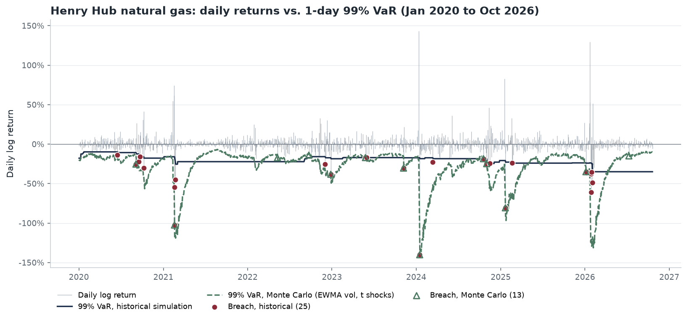

# Energy Commodity Risk Model: VaR and Expected Shortfall for Henry Hub Natural Gas

**If I hold a long position in natural gas, how much could I lose in one day, and can I trust that number?**

I built a one-day Value at Risk (VaR) and Expected Shortfall (ES) model for Henry Hub natural gas. I calculate it four ways: historical simulation, parametric normal, parametric Student-t, and Monte Carlo. Then I **backtest** each one on almost 17 years of daily data. Every day, each model forecasts tomorrow's VaR using only past data, and I test whether the real losses broke through it as often as they should.



*The 99% VaR from historical simulation (navy) barely moves when a cold snap hits, so it gets breached several days in a row. The Monte Carlo VaR (green, dashed) uses EWMA volatility, so it widens within days of a shock and narrows again once the market calms down.*

## The data

| | |
|---|---|
| **Series** | Henry Hub Natural Gas Spot Price, US$/MMBtu, daily ([FRED: DHHNGSP](https://fred.stlouisfed.org/series/DHHNGSP), sourced from the U.S. Energy Information Administration) |
| **Sample used** | 2 January 2008 to 20 October 2026: 4,724 prices, 4,723 daily log returns |
| **Cached copy** | [`data/henry_hub_daily.csv`](data/henry_hub_daily.csv), downloaded 22 October 2026, so the notebook runs offline |

FRED's series starts in 1997, but before 2008 about half the trading days are blank. A return across a gap would really be a multi-day return, so I start in 2008.

**These returns are far from normal.** Annualised volatility is 114%, excess kurtosis is 113, and the Jarque-Bera test rejects normality with a p-value of essentially zero. Spot gas spikes during cold snaps (Winter Storm Uri in February 2021, the January 2024 freeze, January 2026) and collapses when the weather passes. The worst day in the sample was a −140% log return on 16 January 2024. For a long position, the biggest losses come the day after a spike.

## The method

**Returns.** Daily log returns, r<sub>t</sub> = ln(P<sub>t</sub> / P<sub>t−1</sub>). VaR and ES are quoted as positive losses, as a fraction of the position.

**Four ways to estimate 1-day 95% and 99% VaR and ES**, each using the previous 500 trading days (about two years):

| Method | How it works | Assumption |
|---|---|---|
| **Historical simulation** | VaR is the 5th or 1st percentile of the last 500 returns; ES is the average of the returns beyond it. | The next day looks like a random day from the last two years. |
| **Parametric normal** | VaR = −(μ + σ·z<sub>α</sub>). ES uses the closed-form normal formula. | Returns are normal. |
| **Parametric Student-t** | Fit a t distribution by maximum likelihood, then use its closed-form quantile and ES. | Returns are fat-tailed but have constant volatility. |
| **Monte Carlo (EWMA-t)** | Simulate 10,000 possible tomorrows as σ<sub>t</sub>·z. σ<sub>t</sub> is the RiskMetrics EWMA volatility (λ = 0.94); z is a Student-t shock fitted to past standardised returns r<sub>t</sub>/σ<sub>t</sub>. VaR and ES are read off the simulated returns. | Volatility clusters, and shocks are fat-tailed. |

**Backtest.** From January 2010 to October 2026 (4,223 days), each model forecasts the next day's VaR every day, out of sample. A **breach** is a day when the real loss is bigger than VaR. I test the breaches three ways:

- **Kupiec proportion-of-failures (POF) test:** is the breach rate consistent with 5% (or 1%)?
- **Christoffersen independence test:** do breaches arrive independently, or do they cluster?
- **Conditional coverage:** both tests combined.

I also compare the real average loss on breach days with the ES each model predicted for those days.

## Results

### Backtest, January 2010 to October 2026 (4,223 days)

A p-value below 0.05 means I reject the model at the 5% significance level (❌).

| Level | Method | Expected breaches | Actual breaches | Breach rate | Kupiec p | Christoffersen p | Cond. coverage p | Real loss ÷ ES on breach days |
|---|---|---:|---:|---:|---:|---:|---:|---:|
| 99% | Historical | 42 | 53 | 1.26% | 0.109 ✅ | 0.000 ❌ | 0.000 ❌ | 1.04 |
| 99% | Normal | 42 | 55 | 1.30% | 0.059 ✅ | 0.000 ❌ | 0.000 ❌ | **1.72** |
| 99% | Student-t | 42 | 51 | 1.21% | 0.189 ✅ | 0.000 ❌ | 0.000 ❌ | 1.19 |
| 99% | **Monte Carlo (EWMA-t)** | 42 | 37 | 0.88% | 0.409 ✅ | 0.419 ✅ | 0.512 ✅ | 0.76 |
| 95% | Historical | 211 | 223 | 5.28% | 0.407 ✅ | 0.000 ❌ | 0.000 ❌ | 1.04 |
| 95% | Normal | 211 | 135 | 3.20% | 0.000 ❌ | 0.000 ❌ | 0.000 ❌ | 1.48 |
| 95% | Student-t | 211 | 256 | 6.06% | 0.002 ❌ | 0.000 ❌ | 0.000 ❌ | 1.05 |
| 95% | Monte Carlo (EWMA-t) | 211 | 239 | 5.66% | 0.054 ✅ | 0.023 ❌ | 0.012 ❌ | 0.85 |

Full numbers: [`results/backtest_results.csv`](results/backtest_results.csv).

### What I take from it

1. **Normality hides the size of the bad days.** The normal model's 99% breach count looks borderline, but on breach days the real loss was **1.7 times** the ES it predicted. At 95% it fails the other way: the spikes inflate σ, so VaR is too high and there are too few breaches.
2. **Getting the breach count right is not enough.** Historical simulation and Student-t both pass Kupiec at 99% but fail Christoffersen badly. Their breaches cluster because a fixed two-year window reacts slowly when volatility jumps.
3. **Modelling volatility clustering fixes most of this.** The Monte Carlo model with EWMA volatility is the only one that passes all three tests at 99%. Its ES is conservative: real tail losses averaged 76% of the ES it predicted.
4. **No model passes everything at 95%.** Even the Monte Carlo model shows some clustering at 95%, so a better volatility model is the next step.

### Today's numbers (forecast for the trading day after 20 October 2026)

| Method | 95% VaR | 95% ES | 99% VaR | 99% ES | 99% VaR on a $1m long |
|---|---:|---:|---:|---:|---:|
| Historical | 10.9% | 25.5% | 35.0% | 52.8% | $349,622 |
| Normal | 19.4% | 24.3% | 27.5% | 31.5% | $274,553 |
| Student-t | 10.3% | 21.4% | 24.3% | 47.9% | $242,536 |
| Monte Carlo (EWMA-t) | 5.0% | 8.9% | 10.9% | 17.8% | $108,577 |

These differ by a factor of three. The last two years include the January 2026 spike, which still dominates the three window-based methods. EWMA volatility is now 3.2% a day, against a two-year standard deviation of 11.8%, so the Monte Carlo model says the market is much calmer today. Based on the backtest, I trust the Monte Carlo number most, with the caveats below.

## Limitations

- **Fat tails.** Spot gas tails are so heavy that the fitted Student-t has a median of 2.2 degrees of freedom, and 38% of the monthly fits hit my floor of 2.05, where the variance is barely finite. Any 99% estimate rests on a handful of extreme days.
- **Volatility clustering.** EWMA with a fixed λ = 0.94 is the RiskMetrics default for daily data. It is a borrowed choice, not one I estimated for gas, and clustering is still visible at 95%.
- **Regime shifts.** Gas behaves differently in winter, in shale-era oversupply and in LNG-export-driven markets. A 500-day window mixes regimes, and no model here knows the season.
- **Normality assumption.** The normal model is included as a benchmark. The data rejects it, and its ES understates tail losses badly.
- **Spot, not a tradable position.** Henry Hub spot is a physical day-ahead price. Most hedges use NYMEX futures, which are much less spiky. A one-day VaR on spot overstates what a futures book would see, and it ignores liquidity: a large position cannot be exited in one day.
- **One-day horizon, one asset.** No multi-day scaling, no portfolio or correlation effects.

## Next steps

- Replace EWMA with a **GARCH(1,1)** model estimated on the data, and compare backtests.
- Add **filtered historical simulation** (bootstrap the standardised residuals instead of assuming a t distribution).
- Add a formal **ES backtest** (for example Acerbi-Szekely).
- Run the same model on **NYMEX front-month futures**, **WTI crude** and **power prices**, then build a multi-commodity portfolio VaR with correlations.
- Add a **seasonal** term so winter risk is modelled separately.

## How to run it

You need Python 3.10 or newer. From the repository folder:

```bash
python -m venv .venv
.venv\Scripts\activate
pip install -r requirements.txt
```

On macOS or Linux, activate the environment with `source .venv/bin/activate` instead.

Then open [`notebooks/energy_var_model.ipynb`](notebooks/energy_var_model.ipynb) in VS Code (choose the `.venv` kernel) and click **Run All**. You can also run `pip install jupyter` and then `jupyter notebook`. The backtest takes about 30 seconds.

The notebook is saved with its outputs, so you can also just read it on GitHub.

## Project structure

```
energy-var-model/
├── data/henry_hub_daily.csv       cached FRED download
├── src/
│   ├── data.py                    load prices, compute log returns
│   ├── var_models.py              historical, normal, Student-t, EWMA, Monte Carlo VaR/ES
│   ├── backtest.py                rolling forecasts, Kupiec and Christoffersen tests
│   └── plotting.py                the chart above
├── notebooks/energy_var_model.ipynb   runs everything and explains each step
├── results/backtest_results.csv
├── images/var_breaches_99.png
└── requirements.txt
```

---

Stefani Adela Oyong · M.S. Computational Finance & Risk Management, University of Washington · [stefanioyong.github.io](https://stefanioyong.github.io)
